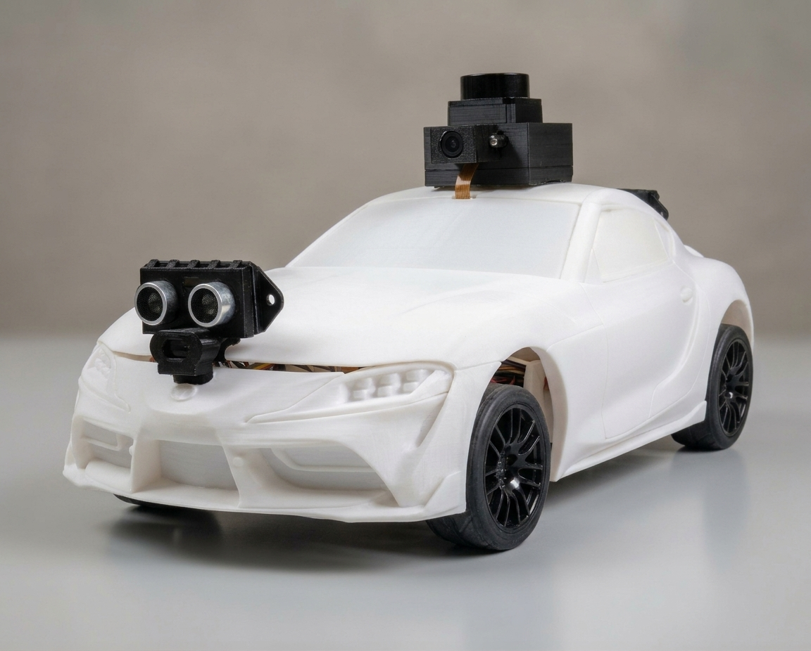
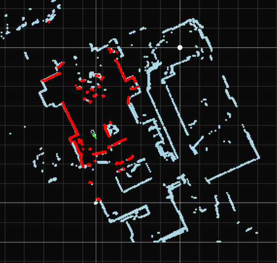

# ESP32 RC car and Rust ground station

A 1/10 RC car (Supra MK5 body, 3D printed chassis) built from scratch: a custom PCB, two ESP32-S3 running C firmware (ESP-IDF), and a Rust ground station that drives the car, shows the sensors and builds a 2D map (SLAM).

<p align="center">
  
  
</p>

## What it does

- **Drive** the car with a gamepad over Wi-Fi (UDP), with configurable acceleration profiles, an emergency brake and front / rear obstacle blocking
- **Sense**: IMU, lidar, ToF, ultrasonic, GNSS, camera (JPG stream), wheel encoder, battery voltage and motor current
- **Ground station** (laptop): egui GUI, record and replay, OTA updates, odometry, 2D SLAM (NDT and ICP)
- **Remote**: a Tailscale relay forwards the data without the GUI

## How it fits together

```
 sensors / motor / servo
          |
   custom PCB (KiCad)
          |
  ESP32-S3 control (C, ESP-IDF) --.
                                   >--- UDP over Wi-Fi ---> rust_station (laptop, egui)
  ESP32-S3 camera  (C, ESP-IDF) --'                          |  odometry, SLAM, record / replay
          ^                                                   |
          '------------- commands (gamepad, every 30 ms) -----'
```

## Repo

| Folder | Content |
|---|---|
| [`esp_project`](esp_project) | ESP-IDF firmware (C): the libraries and the car firmware |
| [`rust_station`](rust_station) | Rust ground station ([`station`](rust_station/station)) and AI training ([`train_ia`](rust_station/train_ia)) |
| [`hardware`](hardware) | KiCad project of the PCB, power and wiring |

The same ESP-IDF libraries were also used for a Zigbee home hub (ESP32-C6). They are easy to reuse to test sensors, MQTT, OTA, ESP-NOW, encryption or Wi-Fi.

## Hardware

| Part | Model |
|---|---|
| Body / chassis | Supra MK5 1/10, 3D printed chassis (Dukedoks design), full PLA |
| Battery | LiPo 7.3 V, 3000 mAh, 25C |
| Motor / driver | Brushed 550 (21T), BTS7960 H-bridge |
| Steering | MG996R servo |
| Boards | ESP32-S3 N16R8 (control), ESP32-S3 (camera) |
| Camera | OV5640, 120° lens <!-- TODO: check, it was in the TODO list of my notes --> |
| Sensors | BNO085 IMU, D500 lidar, BZ181 GNSS, TOF400C (front), HC-SR04 (front / rear), ACS758 50 A current sensor, FC-33 optical encoder |
| Other | KY-006 passive buzzer, 2x Mini560 Pro buck converters (5 V / 3.3 V) |

Power and wiring details are in [`hardware`](hardware).

## Status

| Done | In progress / planned |
|---|---|
| UDP control and telemetry, OTA | Check the camera with sleep / framerate |
| Acceleration profiles, emergency brake | Wi-Fi hotspot setup, cleaner logs |
| Odometry (IMU + encoder) | Chunked grid, better log-odds |
| 2D SLAM (NDT, ICP) | Sensor fusion (accelerometer / odometry / camera) to detect and correct slipping |
| Record and replay | Second, phase-shifted encoder to get the direction |
| egui GUI, Tailscale relay | Pure Pursuit with waypoints |
| ESP-NOW library (not used on the car yet) | Exploration algorithm on the grid |
| | Rear camera |
| | AI for control |
| | Custom controller (ESP-NOW) |
| | Real Tamiya TT02 chassis, new clean body (PETG / clear PETG / TPU) |

## Docker (ESP-IDF)

You can use the minimal Dockerfile of this repo (Windows-friendly) or the one from [Espressif](https://github.com/espressif/esp-idf/blob/master/tools/docker/Dockerfile).

```bash
docker build -t esp32-idf .
docker run -it --rm --network host --device=/dev/ttyUSB0 -v $(pwd):/workspace esp32-idf
```

<details>
<summary>Windows + WSL (USB passthrough)</summary>

Share the USB device from Windows to WSL:

```bash
ls /dev/ttyUSB*
usbipd list
usbipd bind --busid 2-3
usbipd attach --wsl --busid 2-3
```

Then launch the container from PowerShell:

```bash
usbipd attach --wsl --busid 2-3

# using /mnt/c from WSL (works, but slow)
cd D:\ESP32
wsl
docker run -it --rm --network host --device=/dev/ttyUSB0 -v $(pwd):/workspace esp32-idf

# better for performance: stay inside WSL and sync files with GitHub
wsl
cd ~/projects/ESP32
docker run -it --rm --network host -v $(pwd):/workspace esp32-idf:latest
```

</details>

## Run the station

See [`rust_station`](rust_station) for the details of the station.